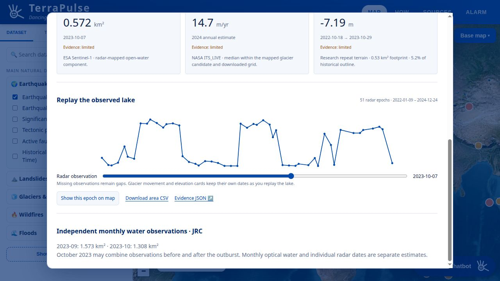
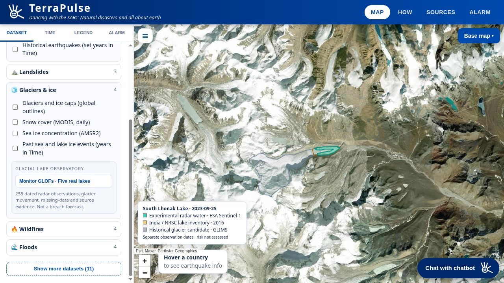

# Active interface connection repairs

This patch follows integration commit `87a2d32` without changing model weights,
scientific results or source data.

## Repairs

| Problem | Change |
| --- | --- |
| GLOF sidebar button had no handler | Register `glof` in the active Leaflet tool dispatcher. Lazy-mount the existing React observatory only. |
| React observatory was absent from the entry page | Add `glof-mount.jsx`, mount once, and support `/?glof=<site>` shared links. |
| Epoch-map button imported the retired MapLibre app | Inject the map callback. Active Leaflet renders the selected date's GeoJSON with separate historical glacier/Indian inventory layers and dated legend/popups. The legacy React entry supplies its own callback. |
| GLOF styles relied on the old global theme | Add a scoped NISASTER theme for the dialog and legend. |
| Exposure UI called a missing endpoint | Restore the existing bounded Overpass endpoint, geometry-screening module and its tests from `landslide-human-exposure`. Add Vercel execution-time configuration. |
| Local chat/exposure routes were absent | Local HTTP dispatch uses the same individual function handlers as deployment, including chat's GET and POST routes. |
| Chat could not launch GLOF monitoring | Add the explicit tool intent and keep GLOF accuracy questions separate from the optical scar benchmark. |

## Verification on 15 November 2026

- 43 Python API/model/chat/exposure tests passed. New real-HTTP tests cover
  the actual local dispatcher, GLOF/landslide endpoints, chat POST, invalid
  requests, exposure geometry screening, and provider failure returning 503.
  Successful exposure geometry tests use an explicitly mocked acquisition
  source, not fabricated production data.
- Five frontend plotting/projection tests passed.
- Production Vite build and Python compilation passed. The active build now
  includes the GLOF widget without the retired MapLibre application bundle.
- Browser tested the **production preview**, with the real Python server:
  sidebar launch, normal/expert modes, loaded indicator maps, unavailable
  Palcacocha measurements, date replay, 25 September 2023 lake geometry on
  Leaflet, shared Tsho Rolpa link, and a chat POST opening the observatory.
- The dialog had no horizontal overflow at the observed desktop viewport.
- A live public Overpass lookup timed out. The endpoint and UI correctly
  returned unavailable, with no asset counts or safety conclusion substituted.
  Live OSM results remain dependent on that external service's availability.

## Recheck locally

```sh
python -m pip install -r requirements.txt
python api/landslide.py
# another terminal
npm ci
npm run dev
```

Open Dataset → Glaciers & ice → Monitor GLOFs. Select a radar epoch and show
it on the map. In chat, send “Open GLOF monitoring”. For exposure, open
Dataset → Landslides → Buildings & human exposure and explicitly submit a
nominated point. Missing/busy source data must remain unavailable.

If port 8765 is occupied, set `TERRAPULSE_API_PORT=8767` for Python and
`TERRAPULSE_API_URL=http://127.0.0.1:8767` for Vite. Both Vite development and
production preview use the configured API proxy.




